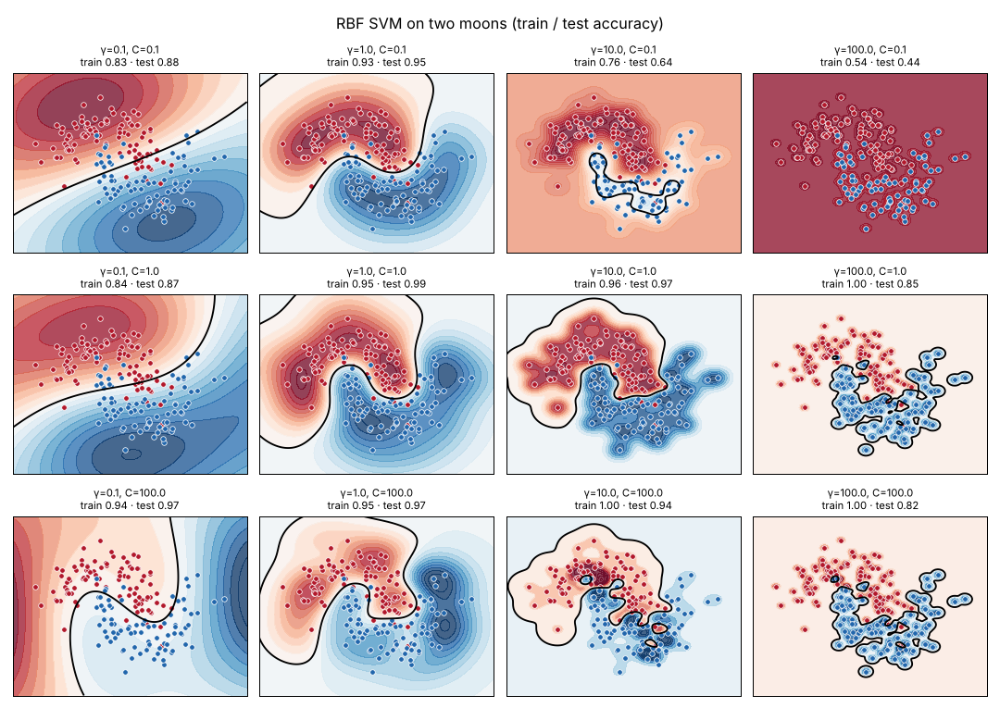

<div align="center">

# RBF Kernel Explorer

**Learn, see and use the RBF (Gaussian) kernel:** an interactive website, a small tested Python package, and reproducible examples.

[](https://github.com/lunganlungpg/rbf-kernel-/actions/workflows/ci.yml)
[](https://lunganlungpg.github.io/rbf-kernel-/)
[](pyproject.toml)
[](LICENSE)

### [▶ Open the interactive explorer](https://lunganlungpg.github.io/rbf-kernel-/)

</div>

$$K(x, x') = \exp\left(-\gamma\,\lVert x - x' \rVert^2\right), \qquad \gamma = \frac{1}{2\sigma^2}$$

The RBF kernel turns *distance* into *similarity*: identical points score 1, distant points score close to 0, and **γ** sets how quickly similarity fades. That one idea powers non-linear SVMs, kernel ridge regression and Gaussian processes.

## Contents

- [What's in this repository](#whats-in-this-repository)
- [Quick start](#quick-start)
- [Understanding γ and C](#understanding-γ-and-c)
- [Reproducible results](#reproducible-results)
- [API reference](#api-reference)
- [Scaling to large datasets](#scaling-to-large-datasets)
- [Common mistakes](#common-mistakes)
- [FAQ](#faq)
- [Further reading](#further-reading)

## What's in this repository

| Part | What it gives you | Where |
|---|---|---|
| 🌐 **Interactive explorer** | Kernel profile, draggable similarity map, and a **live kernel classifier** in the browser that shows training vs leave-one-out accuracy | [`site/index.html`](site/index.html) · [live](https://lunganlungpg.github.io/rbf-kernel-/) |
| 📦 **`rbfkernel` R package** | Kernel ridge (exact leave-one-out tuning), RBF SVMs, random Fourier features, Nyström, and **`rbf_workflow()`: one call that models any data frame** (classification or regression), evaluates on held-out data and exports results | [`R-package/`](R-package) |
| 🐍 **`rbf_kernel` package** | Readable NumPy implementations: RBF kernel, γ heuristics, kernel ridge, Random Fourier Features, Nyström, leak-free SVM tuning | [`rbf_kernel/`](rbf_kernel) |
| 🧪 **Examples** | Five runnable scripts, from "what is K?" to tuned real-data models | [`examples/`](examples) |
| 📚 **Case studies** | How RBF models are set up in healthcare, biometrics, security, finance and OCR | [`site/case-studies.html`](site/case-studies.html) · [summary](docs/case-studies.md) |
| ✅ **Tests** | Every kernel function is checked against scikit-learn | [`tests/`](tests) |

```
rbf-kernel-/
├── R-package/           # the rbfkernel R package (workflow, vignette, tests)
├── rbf_kernel/          # the Python package
│   ├── kernels.py       #   rbf_kernel, pairwise distances, gamma heuristics
│   ├── approx.py        #   RandomFourierFeatures, NystroemRBF
│   ├── models.py        #   KernelRidgeRBF (from scratch)
│   ├── tuning.py        #   make_rbf_svc, tune_rbf_svc, gamma_grid
│   └── plotting.py      #   plot_decision_boundary (optional, needs matplotlib)
├── examples/            # 01–05 runnable scripts
├── tests/               # pytest suite
├── site/                # static website deployed to GitHub Pages
└── docs/                # images and case-study summary
```

## Quick start

**Just want to understand the kernel?** Open the [interactive explorer](https://lunganlungpg.github.io/rbf-kernel-/). No install needed. To run it offline, open `site/index.html` in any browser.

**Want to use the code?**

```bash
git clone https://github.com/lunganlungpg/rbf-kernel-.git
cd rbf-kernel-
python -m venv .venv && source .venv/bin/activate      # Windows: .venv\Scripts\activate
pip install -e ".[plot]"                               # numpy, scipy, scikit-learn, matplotlib
python examples/01_kernel_basics.py
```

Or install straight from GitHub: `pip install "git+https://github.com/lunganlungpg/rbf-kernel-.git"`.

**Using R?** Install the companion package and model any dataset in one call:

```r
remotes::install_github("lunganlungpg/rbf-kernel-", subdir = "R-package", build_vignettes = TRUE)
library(rbfkernel)
wf <- rbf_workflow(breast_cancer, target = "diagnosis", output_dir = "results")
```

**Compute a kernel matrix** (this block is run as a test, so it is guaranteed to work):

```python
>>> import numpy as np
>>> from rbf_kernel import rbf_kernel, gamma_to_sigma
>>> X = np.array([[0.0, 0.0], [1.0, 0.0], [3.0, 0.0]])
>>> np.round(rbf_kernel(X, gamma=0.5), 3)
array([[1.   , 0.607, 0.011],
       [0.607, 1.   , 0.135],
       [0.011, 0.135, 1.   ]])
>>> round(gamma_to_sigma(0.5), 3)   # gamma 0.5 means a Gaussian width of sigma = 1
1.0

```

**Train a properly tuned RBF SVM** in three lines. Scaling happens inside the pipeline, so cross-validation never leaks test information:

```python
from sklearn.datasets import load_breast_cancer
from sklearn.model_selection import train_test_split
from rbf_kernel import tune_rbf_svc

X, y = load_breast_cancer(return_X_y=True)
X_train, X_test, y_train, y_test = train_test_split(X, y, stratify=y, random_state=0)

search = tune_rbf_svc(X_train, y_train)  # StandardScaler + SVC, grid over gamma and C
print(search.best_params_, search.score(X_test, y_test))
```

## Understanding γ and C

γ sets the **reach** of each training point. C (or λ = 1/C in ridge models) sets how hard the model tries to **fit every point**. Both push in the same direction, so tune them together.

| | Too low | Too high |
|---|---|---|
| **γ** | Near-linear, over-smooth boundary. Underfits. | Islands around individual points. Overfits. |
| **C** | Ignores many points. Underfits. | Bends to fit every noisy point. Overfits. |



<sub>Generated by [`examples/02_gamma_c_grid.py`](examples/02_gamma_c_grid.py). Each panel shows train and test accuracy. Top right (γ=100): pure memorisation. Left column (γ=0.1): too smooth to follow the moons.</sub>

**Good starting values**

- `gamma="scale"`, which is `1 / (n_features * X.var())`. On standardized data that is just `1 / n_features`.
- The **median heuristic**, `rbf_kernel.median_heuristic_gamma(X)`: set σ to the median distance between points.
- `C=1`, then search both on a log grid such as γ ∈ 10⁻³…10² and C ∈ 10⁻²…10³.

**Useful conversions**

| Quantity | Formula |
|---|---|
| Width from γ | σ = √(1 / 2γ) |
| Distance where K = 0.5 | d = √(ln 2 / γ) |
| Distance beyond which K < 0.01 | d ≈ 2.15 / √γ (about 3σ) |

## Reproducible results

These numbers were produced by the scripts in `examples/` (scikit-learn 1.9, fixed random seeds). Rerun them yourself; small differences across library versions are normal.

| Example | Data | Setup | Result |
|---|---|---|---|
| [`03_breast_cancer.py`](examples/03_breast_cancer.py) | Wisconsin Diagnostic Breast Cancer (569 × 30) | Scaled RBF SVC, γ and C tuned by 5-fold CV on ROC-AUC, 25% held-out test | **Test ROC-AUC 0.994**, accuracy 95.8%, malignant recall (sensitivity) 92.5% |
| [`04_digits_pca.py`](examples/04_digits_pca.py) | scikit-learn 8×8 digits (1,797 × 64) | Scale → PCA (95% variance, 64 → 39 components) → RBF SVC | **Test accuracy 98.4%** |
| [`02_gamma_c_grid.py`](examples/02_gamma_c_grid.py) | Two moons, noise 0.25 | 12 (γ, C) combinations | Best test 99% at γ=1, C=1; γ=100 gives 100% train but only 82–85% test |
| [`05_scaling_up.py`](examples/05_scaling_up.py) | Synthetic, 20,000 × 20 | Exact SVC vs approximations + linear SVM | Exact 90.0% · Nyström-500 87.0% (5× faster to fit) · RFF-1000 85.3% |

> The [case studies page](site/case-studies.html) describes typical RBF setups in five domains. Its headline figures are illustrative scenarios. The table above lists the results you can reproduce from this repository.

## API reference

All functions accept NumPy arrays (1-D input is treated as one feature). The estimators follow the scikit-learn API, so they work in `Pipeline`, `GridSearchCV` and `cross_val_score`.

| Function / class | Purpose |
|---|---|
| `rbf_kernel(X, Y=None, gamma=1.0)` | Kernel matrix `K[i, j] = exp(-γ‖Xᵢ − Yⱼ‖²)` |
| `pairwise_sq_dists(X, Y=None)` | Squared Euclidean distances, numerically safe (never negative) |
| `gamma_scale(X)` | scikit-learn's `gamma="scale"` value |
| `median_heuristic_gamma(X)` | γ from the median pairwise distance |
| `sigma_to_gamma(σ)`, `gamma_to_sigma(γ)` | Convert between width and γ |
| `KernelRidgeRBF(gamma="scale", alpha=1.0)` | From-scratch kernel ridge regression, solving `(K + αI)a = y` |
| `RandomFourierFeatures(gamma, n_components)` | Random feature map with `z(x)·z(x′) ≈ K(x, x′)` |
| `NystroemRBF(gamma, n_components)` | Landmark-based low-rank kernel approximation |
| `make_rbf_svc(gamma, C)` | `StandardScaler` + RBF `SVC` pipeline |
| `tune_rbf_svc(X, y, gammas=None, Cs=..., cv=5, scoring="accuracy")` | Stratified grid search over γ and C. Returns the fitted `GridSearchCV` |
| `gamma_grid(X, n=7, decades=3)` | Log-spaced γ grid centred on `1 / n_features` |
| `plotting.plot_decision_boundary(model, X, y)` | Draw a 2-D classifier's decision function |

## Scaling to large datasets

An exact kernel method stores an n × n matrix (O(n²) memory) and an SVM solver needs between O(n²) and O(n³) time. Beyond roughly 10⁴–10⁵ samples, swap the kernel for an explicit approximate feature map and train a linear model:

```python
from sklearn.linear_model import SGDClassifier
from sklearn.pipeline import make_pipeline
from sklearn.preprocessing import StandardScaler
from rbf_kernel import NystroemRBF  # or RandomFourierFeatures

model = make_pipeline(
    StandardScaler(),
    NystroemRBF(gamma=0.05, n_components=500, random_state=0),
    SGDClassifier(loss="hinge"),
)
```

Nyström usually needs fewer components than Random Fourier Features because it adapts to your data. scikit-learn's own versions are `sklearn.kernel_approximation.Nystroem` and `RBFSampler`.

## Common mistakes

- ❌ **Not scaling features.** The kernel uses raw distances, so a feature measured in thousands drowns out one measured in fractions.
- ❌ **Scaling before splitting.** Fitting the scaler on all the data leaks test information. Put it in a `Pipeline`, as `make_rbf_svc` does.
- ❌ **Tuning γ alone.** γ and C trade off against each other. Search them together.
- ❌ **Trusting training accuracy.** With a large enough γ it is always ~100%. Use cross-validation and a held-out test set.
- ❌ **Accuracy on imbalanced data.** Use `scoring="roc_auc"`, recall or F1, and consider `class_weight="balanced"`.
- ❌ **Exact SVMs on millions of rows.** Use the approximations above.

## FAQ

<details>
<summary><b>Is <code>gamma="auto"</code> deprecated?</b></summary>

No. Both options exist in scikit-learn. `"auto"` uses `1 / n_features`; `"scale"` (the default since 0.22) uses `1 / (n_features * X.var())`, which also adapts to the overall spread of the data. On standardized data they are essentially equal.
</details>

<details>
<summary><b>Why is the kernel "infinite-dimensional"?</b></summary>

Expanding `exp(2γ x·x′)` as a Taylor series shows the RBF kernel equals a dot product of feature vectors containing every polynomial term of every degree, an infinite list. The kernel trick lets the algorithm use those dot products without ever building the vectors.
</details>

<details>
<summary><b>RBF or linear kernel?</b></summary>

Try linear first on high-dimensional sparse data such as text: it is fast and often just as accurate. Use RBF when there are relatively few features and the relationship is non-linear. When unsure, cross-validate both.
</details>

<details>
<summary><b>How is this related to Gaussian processes?</b></summary>

The RBF kernel is the "squared exponential" covariance used in Gaussian processes. Kernel ridge regression with the RBF kernel gives the same mean prediction as a GP with that covariance, with α playing the role of the noise variance.
</details>

## Development

```bash
pip install -e ".[dev]"
ruff check . && ruff format --check .
pytest rbf_kernel tests README.md      # unit tests + doctests, including this README
```

See [CONTRIBUTING.md](CONTRIBUTING.md). Issues and pull requests are welcome, especially reports of explanations that were confusing.

## Further reading

- [scikit-learn user guide: Support Vector Machines](https://scikit-learn.org/stable/modules/svm.html) and [RBF SVM parameters](https://scikit-learn.org/stable/auto_examples/svm/plot_rbf_parameters.html)
- Rahimi & Recht (2007), [*Random Features for Large-Scale Kernel Machines*](https://people.eecs.berkeley.edu/~brecht/papers/07.rah.rec.nips.pdf)
- Williams & Seeger (2001), *Using the Nyström Method to Speed Up Kernel Machines*
- Rasmussen & Williams, [*Gaussian Processes for Machine Learning*](https://gaussianprocess.org/gpml/), chapter 4
- [Wikipedia: Kernel method](https://en.wikipedia.org/wiki/Kernel_method)

## License

[MIT](LICENSE). Use it in courses, notebooks and products.
